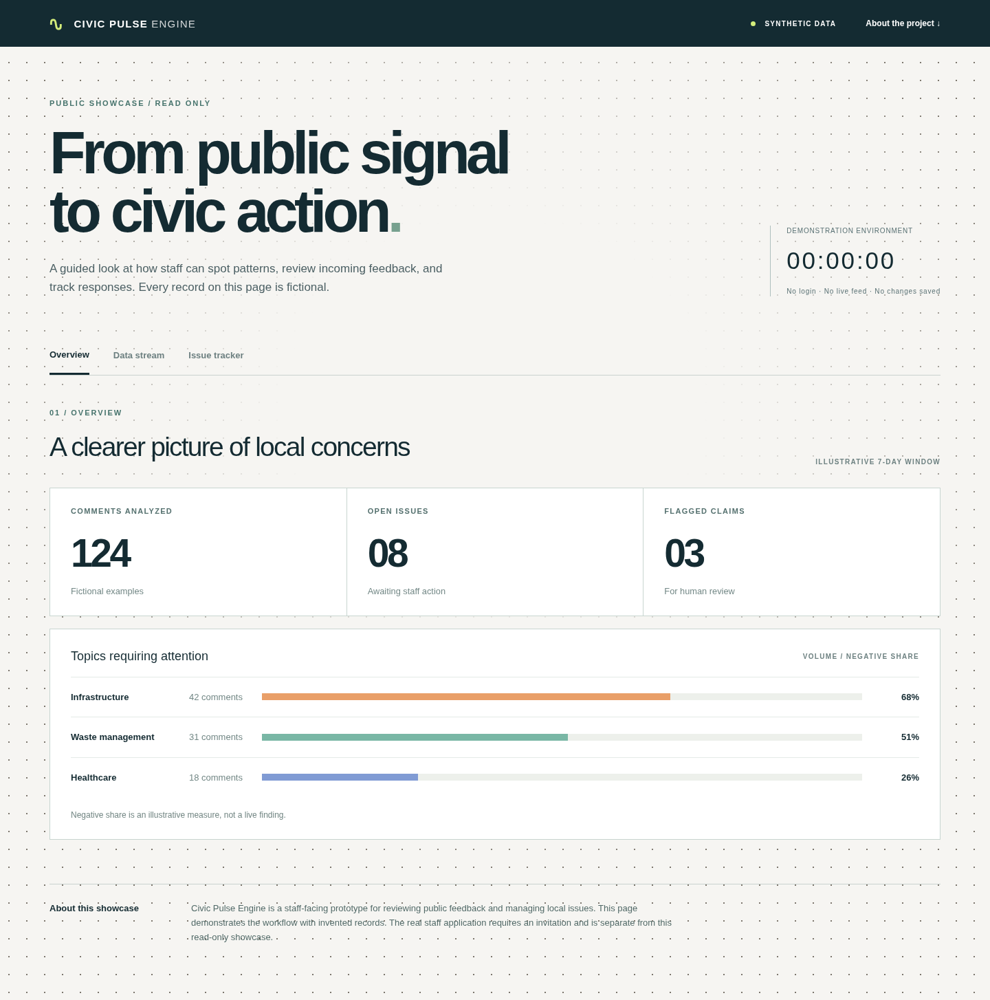
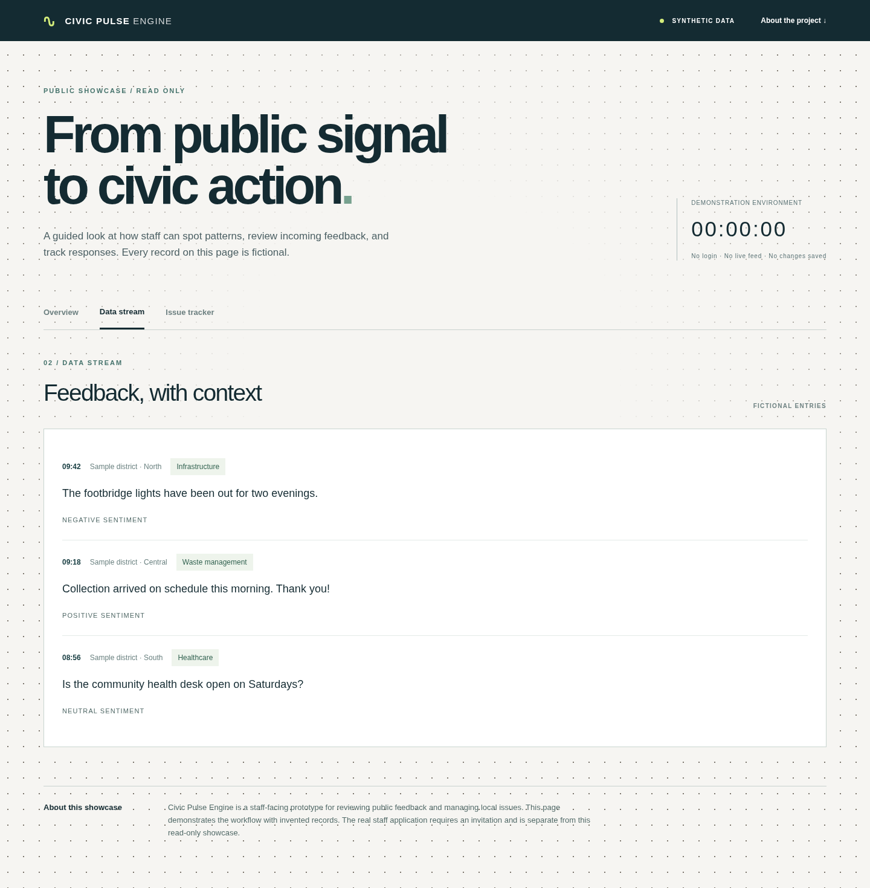
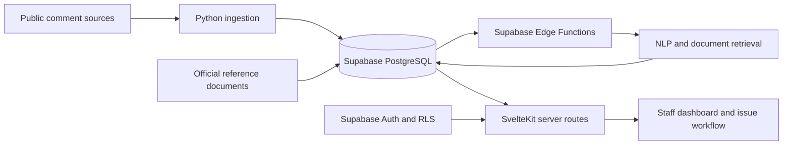

# Civic Pulse Engine

Civic Pulse Engine is a staff-facing civic analytics and issue-management prototype for the Municipality of Pulilan, Bulacan. It turns imported public comments into topic and sentiment summaries, supports human review of flagged claims, and tracks responses to local issues.

> **Data notice:** The screenshots and [read-only showcase](#demo) use fictional records. The staff application requires an invited account. No private citizen dataset is included in this repository.

## Demo

Explore the [live synthetic showcase](https://civic-pulse-engine-demo.vercel.app/demo), or run it locally at `http://localhost:5173/demo` after starting the app. The showcase has no login, live feed, write actions, or production data connection.





## Features

- **Civic overview:** comment totals, sentiment trends, topic priorities, and barangay-level signals.
- **Data stream:** filtered feedback with sentiment, topic, and claim indicators.
- **Claim review:** staff compare flagged statements with retrieved passages from reference documents before recording a decision.
- **Issue management:** board and table views, assignees, status history, discussion, and three-person resolution review.
- **Reports and notifications:** exports, audit history, and staff alerts.
- **Staff access:** invited accounts with server-side role checks and Supabase Row Level Security.

The prototype ingests public YouTube comments through Python scripts and can process configured Facebook sources. Production integrations require separate credentials and a data-use review.

## Architecture



The read-only showcase at `/demo` uses fixed fictional records and does not query the data pipeline. The staff application uses server-side session and role checks; privileged Supabase keys belong only in server environments.

## Tech stack

| Area                     | Technology                                                         |
| ------------------------ | ------------------------------------------------------------------ |
| Web app                  | SvelteKit 2, Svelte 5, TypeScript, Tailwind CSS 4                  |
| API                      | SvelteKit server routes, Supabase Edge Functions (Deno)            |
| Data and auth            | Supabase PostgreSQL, pgvector, Auth, Row Level Security            |
| Maps and charts          | Leaflet, Chart.js                                                  |
| Ingestion and evaluation | Python scripts, Hugging Face NLP service, Groq-backed claim review |
| Deployment               | Vercel for the app; Supabase for data and functions                |

## Run the synthetic showcase

Use **Node.js 22.23.1** (also recorded in `.node-version`) and **pnpm 12.4.2** (pinned in `package.json`). With Corepack available, run `corepack enable` and `corepack prepare pnpm@12.4.2 --activate` to select this pnpm version.

```sh
git clone https://github.com/rayubaldo44/civic-pulse-engine.git
cd civic-pulse-engine
pnpm install --frozen-lockfile
cp .env.demo.example .env.local
pnpm dev
```

Open `http://localhost:5173`. Demo-only mode redirects to `/demo` and returns 404 for staff and API routes. The supplied URL and key are synthetic placeholders; no database account or external integration is needed. Use a fresh browser profile without staff authentication cookies.

To check the source locally:

```sh
pnpm vitest run
pnpm check
pnpm lint
pnpm build
```

For a separate Vercel showcase project, configure `DEMO_ONLY=true`, `PUBLIC_SUPABASE_URL=https://example.supabase.co`, `PUBLIC_SUPABASE_ANON_KEY=demo-placeholder`, `SUPABASE_URL=https://example.supabase.co`, and `SUPABASE_SERVICE_ROLE_KEY=demo-placeholder` (the latter two are unused staff-module placeholders). Supply no production database or integration credentials. Deploy with `vercel deploy --local-config vercel.demo.json --prod`; the demo config omits the staff application's scheduled job. Verify `/demo`, static assets, the root redirect, and staff/API 404 responses after deployment.

## Staff application and limitations

This release is a portfolio capstone prototype specialized for Pulilan, including its barangay geography and civic categories. It is not a supported municipal service or a turnkey installation for another municipality. The showcase illustrates the workflow; its numbers are fictional and are not model accuracy measurements.

The complete staff workflow needs your own Supabase database, Auth configuration, migrations, invited users, reference documents, and separately hosted Hugging Face NLP service. Groq, social-media collection, and email delivery require additional configuration and credentials. That external NLP service and production datasets are not distributed here.

For staff development, replace `.env.local` with a copy of `.env.example`, fill it with your own service settings, and set `DEMO_ONLY=false`. Review the schema and migrations in an isolated development database before using them; fresh production provisioning has not been certified by this portfolio release. Never use the demonstration placeholders as staff credentials.

Integration and browser suites seed and modify data. Run `pnpm test:integration` and `pnpm test:e2e` only against an isolated local test stack. The default showcase requires neither suite nor live NLP ingestion. See [CONTRIBUTING.md](CONTRIBUTING.md) for contribution and verification guidance and [docs/DATABASE_STRUCTURE.md](docs/DATABASE_STRUCTURE.md) for the schema inventory.

## Data and security

- Public comments can still contain identifying details in their text even when author identifiers are hashed. Do not publish collected comments, exports, annotation files, or real dashboard screenshots without review and permission.
- Never put service-role, database, email, social-media, NLP, or cron secrets in source control. Treat credentials previously committed to any history as exposed and rotate or revoke them.
- The app has no public staff signup. Keep production database policies, storage access, and authenticated routes under review before deploying a public endpoint.
- Report suspected vulnerabilities privately using [SECURITY.md](SECURITY.md).

## Contributing and maintenance

Small fixes and documentation improvements are welcome; read [CONTRIBUTING.md](CONTRIBUTING.md) first. Maintenance is best effort, with no guaranteed support period or response time.

## Contributors

- **rayubaldo44** — full stack lead; application architecture, frontend, backend, data integration, and release preparation.

`rayubaldo44` is the sole contributor to the system's software development.

## License

Released under the [MIT License](LICENSE). Copyright © 2026 rayubaldo44.
